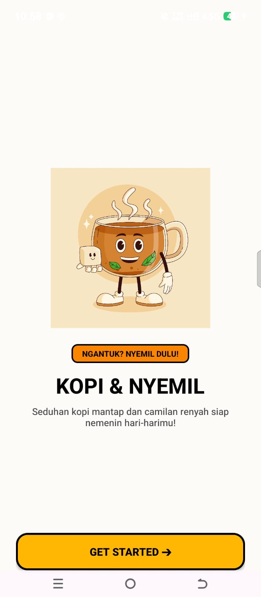
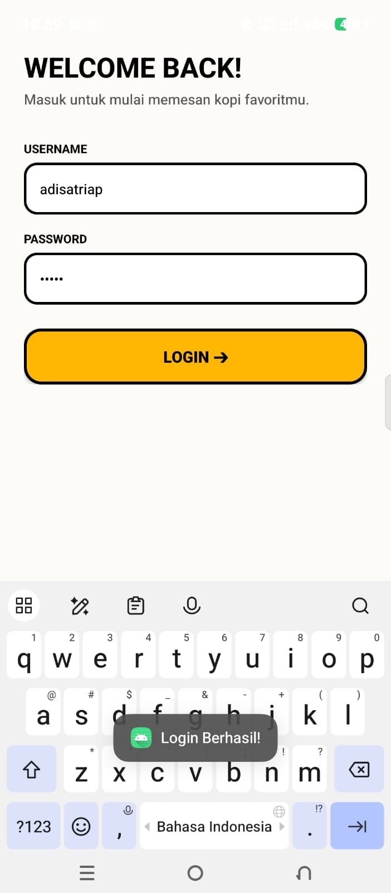
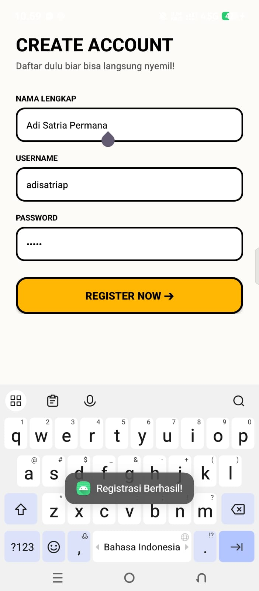
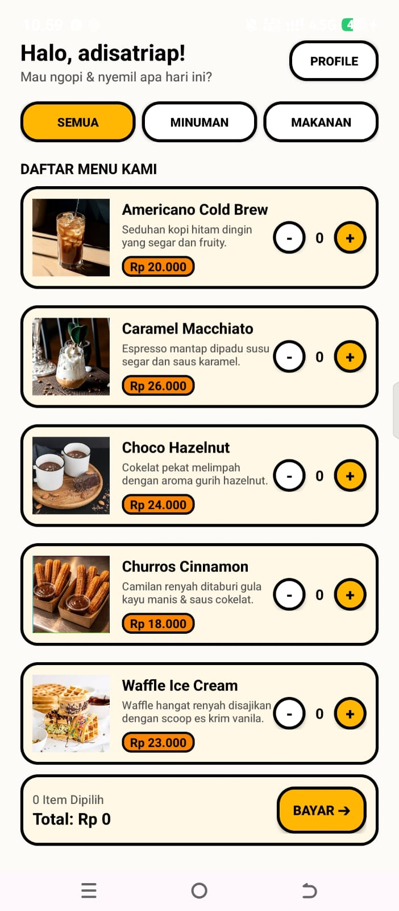
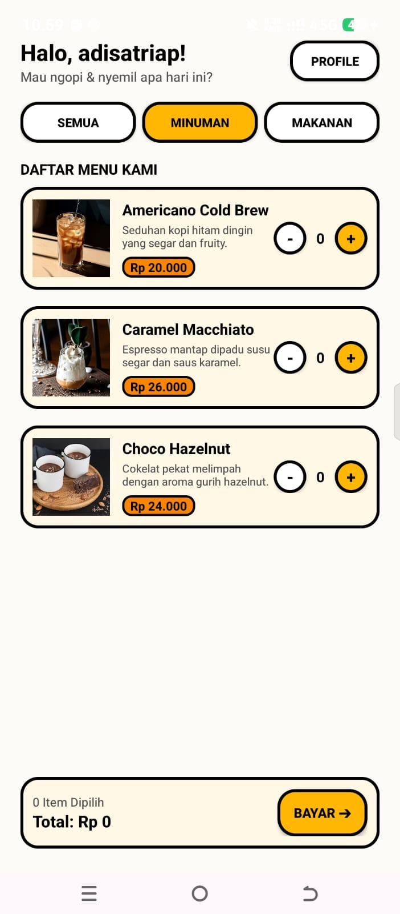
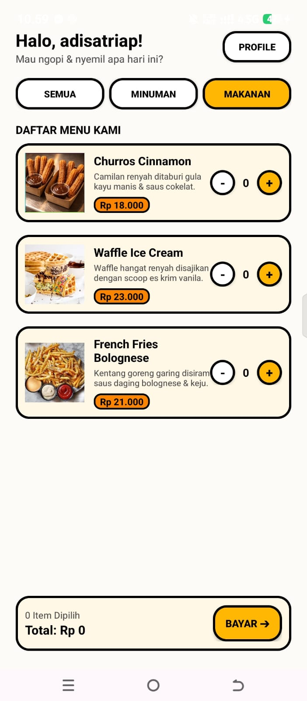
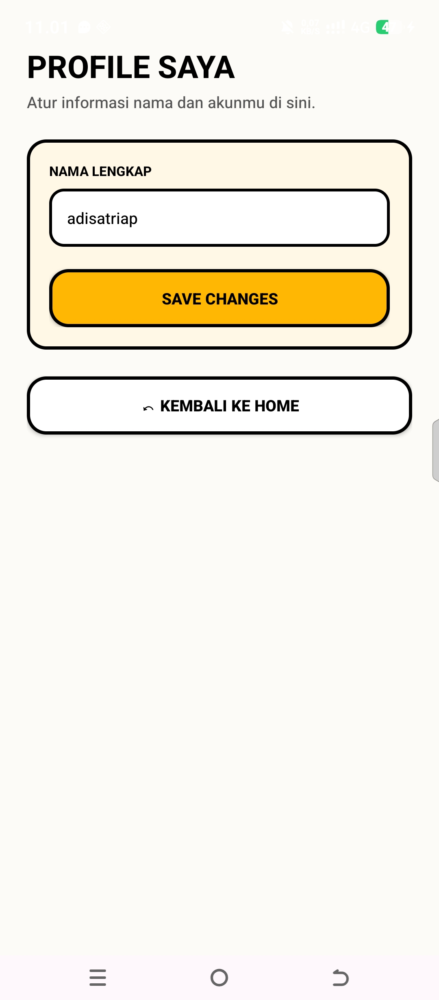
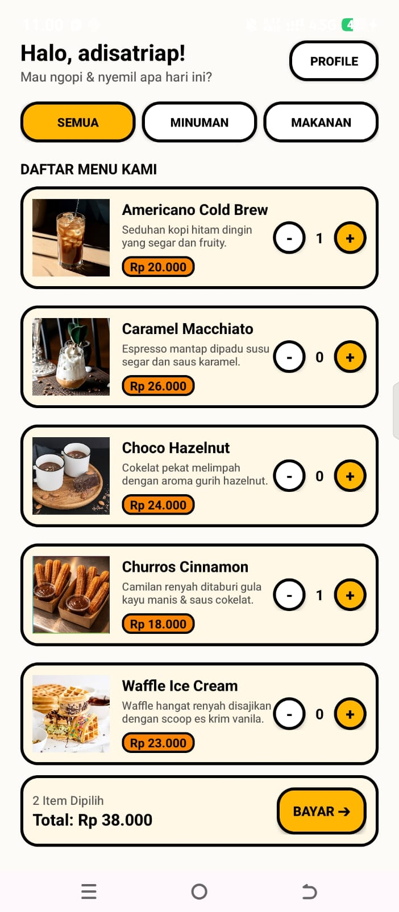
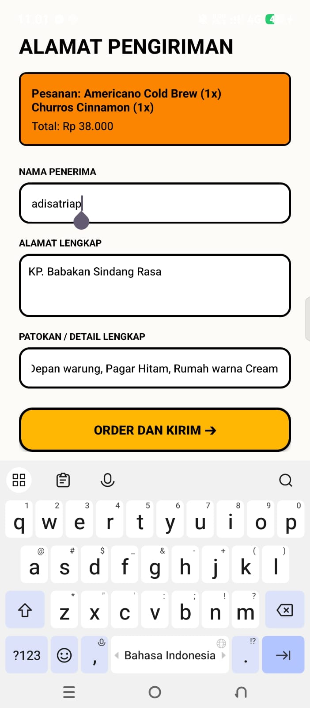
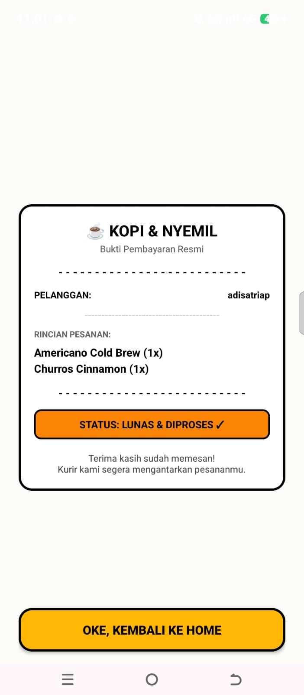

# Nama : Adi Satria Permana
# NIM  : 1247050074 

# LINK PDF Tampilan: https://drive.google.com/drive/folders/1bLQZ5pO_f20L3JAJZNYDXYWDkx3_GaIT?usp=drive_link
# LINK GITHUB : https://github.com/AdiSatriaPermana/UTSPAM
# ☕ Kopi dan Nyemil - Mobile Application (UTS Pengembangan Aplikasi Mobile)
Aplikasi pemesanan makanan dan minuman berbasis mobile berbasis Android Native (Kotlin) dengan antarmuka modern berbatu gaya **Neo-Brutalism**. Aplikasi ini dirancang intuitif untuk memilih menu kopi/camilan, mengatur jumlah kuantitas, hingga mencetak bukti pembayaran berupa struk digital.

---

## 📱 Fitur Utama

- **Splash / Welcome Screen:** Halaman penyambung awal dengan maskot retro dan slogan khas.
- **Autentikasi (Sign Up / Login / Register):** Alur navigasi antar-halaman autentikasi pengguna.
- **Katalog Menu & Filter (Home):** Menampilkan 6 daftar menu (Kopi, Non-Kopi, dan Cemilan) dilengkapi filter kategori (*Semua*, *Minuman*, *Makanan*).
- **Multi-Item Selector & Real-Time Cart Calculation:** Tombol pengatur kuantitas (`+` / `-`) pada setiap item dengan kalkulasi otomatis total item dan total bayar pada *Bottom Pay Bar*.
- **Manajemen Profil:** Pengubahan nama profil pengguna secara dinamis.
- **Form Alamat Pengiriman:** Input nama penerima, alamat lengkap, dan detail patokan pengiriman.
- **Struk Digital (Konfirmasi Pesanan):** Layar penutup transaksi yang dikemas menarik berupa tampilan Struk Belanja Kasir resmi.

---

## 🛠️ Teknologi yang Digunakan

- **Language:** Kotlin
- **IDE:** Android Studio
- **UI Architecture:** XML Layouts (ConstraintLayout & RelativeLayout)
- **Design Style:** Neo-Brutalism (High-contrast borders & bold colors)
- **Component:** RecyclerView, ViewBinding / findViewById, Intent Navigation

---

## 🚀 Cara Menjalankan Aplikasi

### Prasyarat
- Android Studio Ladybug / Jellyfish (atau versi terbaru)
- JDK 17 / Kotlin Plugin
- Emulator Android (API Level 24+) atau Perangkat HP Android fisik

### Langkah-Langkah

1. **Clone repository ini:**
   ```bash
   git clone [https://github.com/AdiSatriaPermana/UTSPAM.git](https://github.com/AdiSatriaPermana/UTSPAM.git)

## 📸 Tampilan Aplikasi

| Splash / Welcome | Sign Up | Login | Register |
| :---: | :---: | :---: | :---: |
|  |  |  |  |

| Home (Semua) | Filter Minuman | Filter Makanan | Profile |
| :---: | :---: | :---: | :---: |
|  |  |  |  |

| Home (Ada Keranjang) | Alamat Pengiriman | Struk Konfirmasi |
| :---: | :---: | :---: |
|  |  |  |